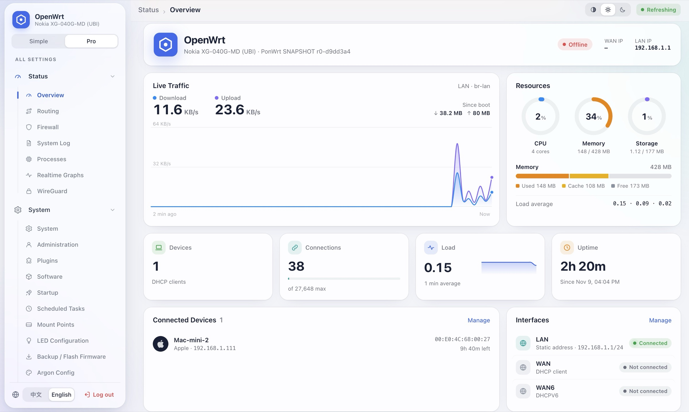
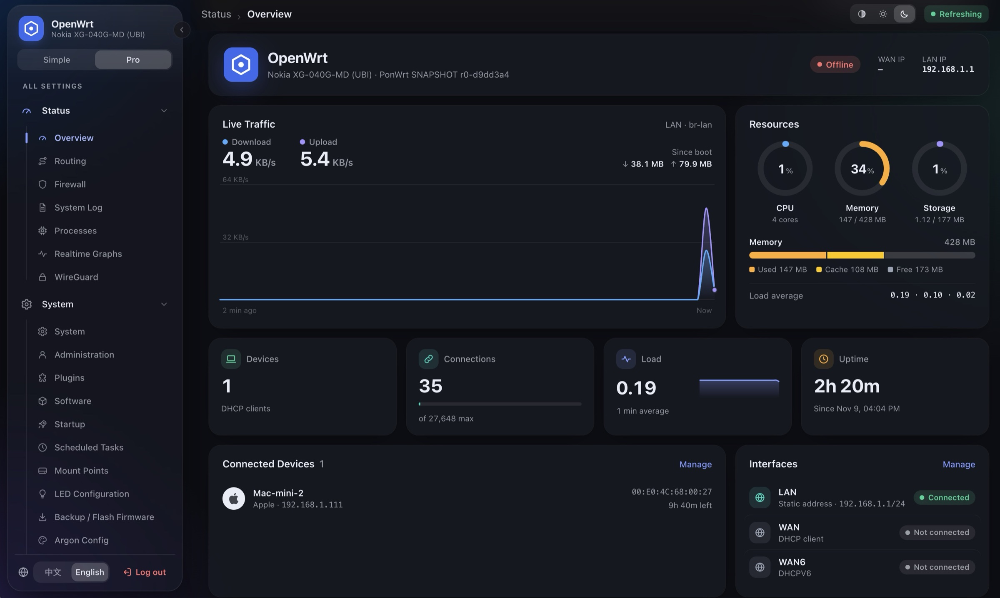

<div align="center">


# luci-theme-carbon

A clean, glass-style LuCI theme for OpenWrt — built for everyday users.

**English** · [简体中文](README.zh-CN.md)

[](https://github.com/mrjoechen/luci-theme-carbon/actions/workflows/build.yml)
[](https://github.com/mrjoechen/luci-theme-carbon/releases/latest)
[](LICENSE)

**[Live demo](https://mrjoechen.github.io/luci-theme-carbon/) · [English demo](https://mrjoechen.github.io/luci-theme-carbon/?lang=en)**

</div>

## Screenshots

<p align="center"></p>

<p align="center"></p>

## Features

- **Dashboard** on *Status → Overview*: live traffic chart, CPU / memory / storage rings, memory breakdown, load sparkline, connection count, uptime, connected devices and interface status. LuCI's original status widgets are kept behind *Show detailed status*.
- **Device brand icons** — connected devices are recognised by hostname and MAC vendor prefix (35 brands, ~9,200 IEEE OUI prefixes).
- **Simple / Pro navigation** — *Simple* shows only the pages most people need (overview, internet, Wi‑Fi, software, password, backup, reboot); *Pro* shows the full LuCI menu with an icon for every page.
- **Frosted-glass sidebar** that collapses into an icon rail (button on the sidebar edge or <kbd>Ctrl</kbd>/<kbd>⌘</kbd> + <kbd>\\</kbd>); hovering a rail icon opens its sub-menu.
- **Light / dark / auto** theme switch (top-right) and **中文 / English** language switch (bottom-left).
- **Mobile friendly** — drawer navigation and tables that reflow into cards.
- **Changes nothing in OpenWrt** — pure front-end package, every LuCI page and plugin keeps working; uninstall to go back.
- Tiny and architecture independent (~80 KB, one package for every router).

## Compatibility

| Firmware | Package manager | Package |
|---|---|---|
| OpenWrt / ImmortalWrt 23.05, 24.10 | opkg | `.ipk` or install script |
| OpenWrt / ImmortalWrt 25.x, snapshot | apk | `.apk` or install script |

Requires the ucode-based LuCI (23.05 or newer).

## Installation

All files are on the [Releases](https://github.com/mrjoechen/luci-theme-carbon/releases/latest) page.

### Option 1 — install script (any firmware, recommended)

Run on the router (SSH):

```bash
wget -O /tmp/carbon-install.sh https://github.com/mrjoechen/luci-theme-carbon/releases/latest/download/carbon-install.sh && sh /tmp/carbon-install.sh
```

If the router has no internet access, download `carbon-install.sh` on your computer and copy it over (`-O` is needed because OpenWrt's SSH server has no SFTP):

```bash
scp -O carbon-install.sh root@192.168.1.1:/tmp/
```

```bash
ssh root@192.168.1.1 "sh /tmp/carbon-install.sh"
```

### Option 2 — opkg (`.ipk`, 23.05 / 24.10)

Upload `luci-theme-carbon_*_all.ipk` in *System → Software → Upload Package*, or:

```bash
opkg install /tmp/luci-theme-carbon_*_all.ipk
```

### Option 3 — apk (`.apk`, 25.x / snapshot)

LuCI's web upload refuses packages that are not signed by your firmware's key, so install over SSH:

```bash
apk add --allow-untrusted /tmp/luci-theme-carbon-*.apk
```

### After installing

Carbon becomes the default theme. Refresh the page, then **log out and log in once** so the dashboard gets its read-only permissions. Switch themes any time in *System → System → Language and Style*.

## Usage

| What | Where |
|---|---|
| Simple / Pro menu | segmented control at the top of the sidebar |
| Collapse sidebar | round button on the sidebar edge, or <kbd>Ctrl</kbd>/<kbd>⌘</kbd> + <kbd>\\</kbd> |
| Light / dark / auto | top-right of the toolbar |
| 中文 / English | bottom-left of the sidebar (changes LuCI's language, same as *System → Language*) |
| LuCI's original status page | *Show detailed status* under the dashboard |

## Uninstall

```bash
sh /tmp/carbon-install.sh uninstall
```

or remove the package with `opkg remove luci-theme-carbon` / `apk del luci-theme-carbon`. The previous theme is restored automatically.

## Building

**Without the SDK** (produces the install script and an `.ipk`):

```bash
sh scripts/build-installer.sh
```

```bash
sh scripts/build-ipk.sh
```

**With the OpenWrt SDK**: put this directory under `package/` and run `make package/luci-theme-carbon/compile`.

**Releases** are built by GitHub Actions: pushing a tag `vX.Y.Z` that matches `PKG_VERSION` in the `Makefile` builds the install script, the `.ipk` (OpenWrt 24.10 SDK) and the `.apk` (OpenWrt 25.12 SDK) and publishes them as a GitHub release.

## Demo & GitHub Pages

The [live demo](https://mrjoechen.github.io/luci-theme-carbon/) uses the actual theme CSS, JavaScript and brand icons. It includes a live mock dashboard, interfaces, searchable devices, Wi-Fi and system forms, software installation, logs, diagnostics, backup and reboot simulations, plus a login preview. Try light/dark/auto appearance, Simple/Pro navigation and 中文/English. Demo settings last for the current browser tab; passwords are never saved and no router is contacted.

**Local preview**: run `python3 -m http.server 8000` in the repo root and open [the preview](http://localhost:8000/preview/index.html). Add `?lang=en` for English. The existing `/preview/form.html` URL opens the wireless demo.

**Build the deployable site** (Python 3, no npm dependencies):

```bash
python3 scripts/build-demo.py
python3 -m http.server 8000 --directory dist/demo
```

Open [the built demo](http://localhost:8000/). The build copies only the preview and required theme assets into `dist/demo/`; relative asset URLs and query-based navigation support project Pages paths and custom domains.

**Automatic deployment**: in the repository's **Settings → Pages → Build and deployment → Source**, select **GitHub Actions** once. After committing and pushing these files to `main`, the **Deploy demo to GitHub Pages** workflow builds and deploys changes to the demo, theme assets or workflow. It also supports manual runs; pull requests build without publishing. The workflow uses the built-in `GITHUB_TOKEN` and needs no custom secrets. Deployment permissions/environment rules must allow `main`. Forks use `https://<owner>.github.io/<repo>/`; update the demo links above when forking.

See [GitHub's Pages workflow documentation](https://docs.github.com/en/pages/getting-started-with-github-pages/using-custom-workflows-with-github-pages).

**Brand data** (`brands.js`) is regenerated with `python3 -I scripts/gen-brands.py`.

## Credits

- Brand glyphs: [Simple Icons](https://simpleicons.org) (CC0 1.0). All trademarks belong to their respective owners.
- MAC vendor prefixes: IEEE Registration Authority MA-L registry.
- Widget behaviour follows the official `luci-theme-bootstrap`.

## License

[Apache License 2.0](LICENSE)
