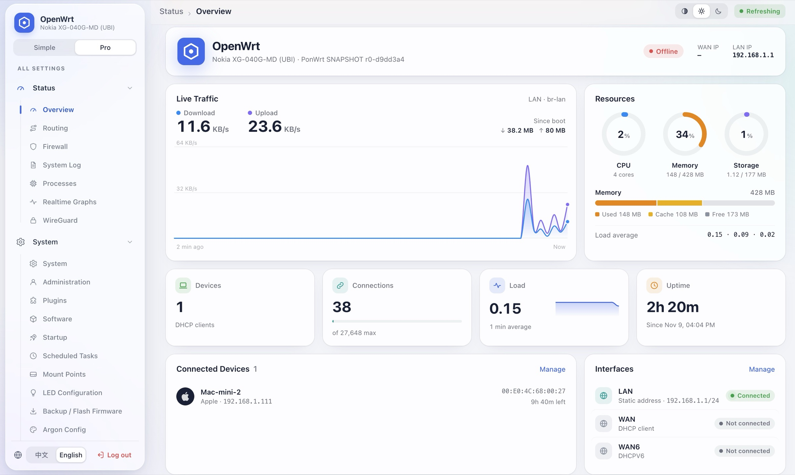
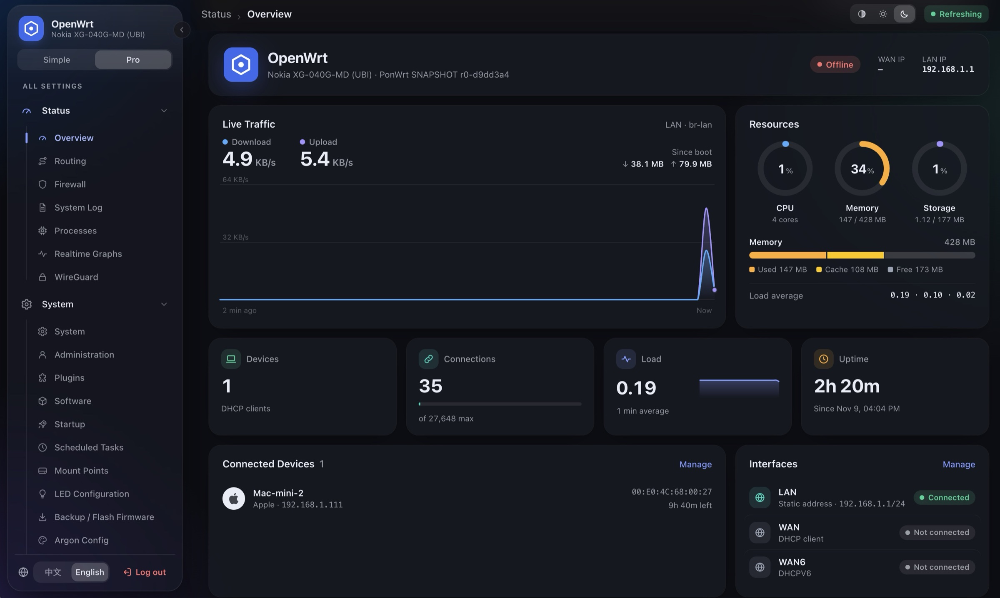

<div align="center">


# luci-theme-carbon

简洁的毛玻璃风格 OpenWrt LuCI 主题，为每一个人设计。

[English](README.md) · **简体中文**

[](https://github.com/mrjoechen/luci-theme-carbon/actions/workflows/build.yml)
[](https://github.com/mrjoechen/luci-theme-carbon/releases/latest)
[](LICENSE)
**[在线演示](https://mrjoechen.github.io/luci-theme-carbon/) · [English demo](https://mrjoechen.github.io/luci-theme-carbon/?lang=en)**

</div>

## 界面预览

<p align="center"></p>

<p align="center"></p>

## 功能

- **仪表盘**（状态 → 概览）：实时流量图、CPU / 内存 / 存储圆环、内存构成条、负载迷你图、连接数、运行时间、在线设备和网络接口状态。LuCI 原有的状态信息保留在「显示详细状态」里。
- **设备品牌图标**：根据主机名和 MAC 厂商前缀识别已连接设备（35 个品牌，约 9200 条 IEEE OUI 前缀）。
- **简洁 / 专业双模式**：简洁模式只显示常用功能（概览、上网、Wi‑Fi、软件包、密码、备份、重启）；专业模式显示完整 LuCI 菜单，每个页面都有对应图标。
- **毛玻璃侧栏**，可收起为只显示图标的窄栏（点侧栏边缘的圆形按钮，或按 <kbd>Ctrl</kbd>/<kbd>⌘</kbd> + <kbd>\\</kbd>），鼠标悬停图标弹出子菜单。
- 右上角切换**浅色 / 深色 / 跟随系统**，左下角切换**中文 / English**。
- **适配手机**：侧栏变为抽屉，表格自动变成卡片。
- **不修改 OpenWrt 任何功能**：纯前端包，所有 LuCI 页面和插件照常使用，卸载即恢复。
- 体积小、与架构无关（约 80 KB，所有路由器通用一个包）。

## 安装与使用

### 兼容性

| 固件 | 包管理器 | 安装包 |
|---|---|---|
| OpenWrt / ImmortalWrt 23.05、24.10 | opkg | `.ipk` 或安装脚本 |
| OpenWrt / ImmortalWrt 25.x、snapshot | apk | `.apk` 或安装脚本 |

需要 ucode 版 LuCI（23.05 及以后）。

所有文件都在 [Releases](https://github.com/mrjoechen/luci-theme-carbon/releases/latest) 页面。

### 方式一：安装脚本（所有固件通用，推荐）

在路由器上执行（SSH 登录后）：

```bash
wget -O /tmp/carbon-install.sh https://github.com/mrjoechen/luci-theme-carbon/releases/latest/download/carbon-install.sh && sh /tmp/carbon-install.sh
```

如果路由器不能上网，先在电脑上下载 `carbon-install.sh` 再传过去（`-O` 不能省，OpenWrt 的 SSH 服务没有 SFTP）：

```bash
scp -O carbon-install.sh root@192.168.1.1:/tmp/
```

```bash
ssh root@192.168.1.1 "sh /tmp/carbon-install.sh"
```

### 方式二：opkg（`.ipk`，23.05 / 24.10）

在「系统 → 软件包 → 上传软件包」上传 `luci-theme-carbon_*_all.ipk`，或执行：

```bash
opkg install /tmp/luci-theme-carbon_*_all.ipk
```

### 方式三：apk（`.apk`，25.x / snapshot）

LuCI 网页上传只接受固件官方签名的包，所以请通过 SSH 安装：

```bash
apk add --allow-untrusted /tmp/luci-theme-carbon-*.apk
```

### 安装之后

Carbon 会自动设为默认主题。刷新页面，然后**退出并重新登录一次**，仪表盘才能读取 CPU、连接数等数据。随时可以在「系统 → 系统 → 语言和界面」切换回其他主题。

### 使用

| 功能 | 位置 |
|---|---|
| 简洁 / 专业菜单 | 侧栏顶部的分段按钮 |
| 收起侧栏 | 侧栏边缘的圆形按钮，或 <kbd>Ctrl</kbd>/<kbd>⌘</kbd> + <kbd>\\</kbd> |
| 浅色 / 深色 / 自动 | 工具栏右上角 |
| 中文 / English | 侧栏左下角（修改的是 LuCI 的界面语言，等同「系统 → 语言」） |
| GitHub 项目主页 | 工具栏右上角的 GitHub 图标 |
| LuCI 原版状态页 | 仪表盘下方「显示详细状态」 |

### 卸载

```bash
sh /tmp/carbon-install.sh uninstall
```

或使用 `opkg remove luci-theme-carbon` / `apk del luci-theme-carbon`。卸载后会自动切回原来的主题。

## 自行构建

**不需要 SDK**（生成安装脚本和 `.ipk`）：

```bash
sh scripts/build-installer.sh
```

```bash
sh scripts/build-ipk.sh
```

**使用 OpenWrt SDK**：把本目录放到 SDK 的 `package/` 下，执行 `make package/luci-theme-carbon/compile`。

**品牌数据**（`brands.js`）可用 `python3 -I scripts/gen-brands.py` 重新生成。

## 声明

- 品牌图标：[Simple Icons](https://simpleicons.org)（CC0 1.0），所有商标归各自所有者。
- MAC 厂商前缀：IEEE Registration Authority MA-L 注册表。
- 组件行为参照官方 `luci-theme-bootstrap`。

本项目采用 [Apache License 2.0](LICENSE) 许可。
